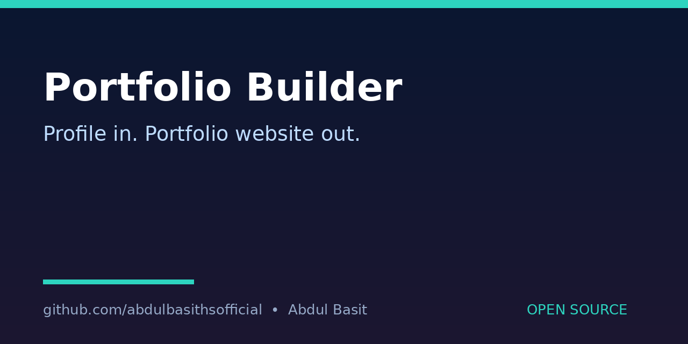

# Portfolio-Builder
Benefit: Generates a simple personal portfolio website from a JSON profile — name, skills, projects and links — so anyone can publish a clean portfolio page without writing HTML by hand.

## What it does
Reads `profile.json` and writes a static `index.html` with your name, headline, skills, projects and links. No server, database or build step is needed; open the HTML file in a browser.

## Quick start
```bash
python3 build.py
python3 build.py --profile profile.json --out index.html
```

## How to run
- Edit `profile.json` with your own details (the sample uses placeholder example text — replace it).
- Run `python3 build.py`, then open `index.html`.
- Host the file anywhere that serves static HTML, or keep it local.
